<p align="center"></p>

<h1 align="center">ax·genealogy</h1>

<p align="center"><strong>Every life is a source. Every family, a river.</strong></p>

<p align="center">
A private website for your family tree, run on your own server.<br>
The whole family lives in one open file you own. Relatives sign in to read it or to correct it.<br>
How sure each fact is stays in plain sight.
</p>

<p align="center">
<a href="#a-tour">Tour</a> ·
<a href="#install">Install</a> ·
<a href="#first-start-three-ways-in">First start</a> ·
<a href="#where-your-data-lives">Your data</a> ·
<a href="#security-it-listens-on-localhost-only">Security</a> ·
<a href="#more">Documentation</a>
</p>

[](docs/screenshots/river-hero.jpg)

<sub>Every screenshot on this page shows the same fictional family: about 250
people from Brittany and Poland, from the 1640s to today. It was generated
for the purpose, and its portraits are generated images. None of these people
existed.</sub>

*(The site calls itself **ax·genealogy**. The repository, the binary, the
service and its system user are all `axgf-cms`.)*

**Who this is for.** Someone in the family who is comfortable running a Linux
server, a VPS or a machine at home, and wants to host the tree for everybody
else. Most of this page is for them. **If you have been sent a `.axgf` file
and just want to look at it, skip to
[Opening a `.axgf` file on your own computer](#opening-a-axgf-file-on-your-own-computer).**

---

## Why ax·genealogy

- **Your family is one file that you own.** People, relationships, dates,
  sources, scanned certificates and photographs all live in `family.axgf`. It
  is an ordinary ZIP of JSON in an [open format](https://github.com/plkarin/axgf-spec),
  so it still opens long after this program is gone. **Admin → Export**
  downloads it at any time.
- **Doubt is part of the record.** Every fact and every parent–child link
  carries how sure it is. The site draws it everywhere: the river's lines are
  solid, dashed or dotted, the tree's cards carry a certainty mark, and every
  chart shows its confidence. A date stays as uncertain as it was given: *circa*,
  *before*, *between*.
- **Private where it should be.** Living relatives are shown only to people
  who are signed in, while their great-grandparents can be public. A living
  person's health, biometrics, genetics and legal records are open to
  administrators only, and any of these can be closed further, person by
  person. All of this is enforced on the server, on every page, photograph
  and download.
- **Relatives help.** You create their accounts and choose what each may do:
  read, correct, or administer. A contributor can be limited to one branch.
  Every change records who made it and when.
- **Any GEDCOM comes in** *(new in 0.5.0; v0.4.3 reads GEDCOM 5.5.1)*. It
  reads GEDCOM 5.5, 5.5.1, 5.5.5 and 7.0, in ANSEL, UTF-8, UTF-16,
  Windows-1252 or Mac Roman. Before anything is kept, it shows you how the
  file was read and what came across.
- **It looks after itself.** One binary, one installer, a verified backup
  every day and a full read-back check every week. Upgrades roll back on
  their own if the new version cannot read your family.

---

## A tour

### The river

The landing page puts one person at the fixed point. Their ancestors flow in
from below, like the sources of a river, and their descendants branch out
above toward the living. Each line is as wide as the descendants it carries,
and its stroke says how sure the link is: solid when attested, dashed when
inferred, dotted when speculative. Click anyone to travel to them. The trail
at the top numbers where you have been, and the record beside the river
follows you.

<p align="center">
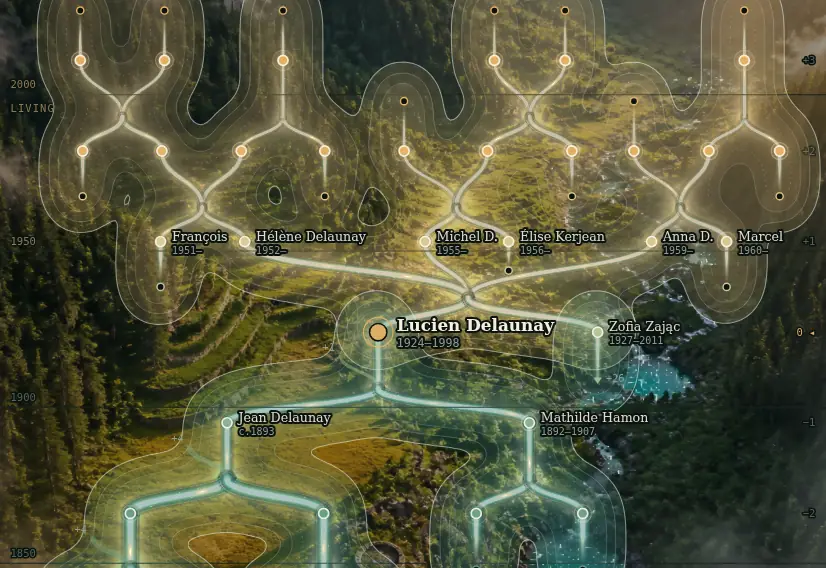
</p>

**The river is alive** *(new in 0.5.0, on `main`)*. Under the drawing, a forest
seen from above is computed in WebGL at your screen's own resolution, so it is
never soft and never pixelated. Low sun on the crowns, hills under the
forest, clearings and wet ground along every line, and mist in the corners.
Gusts cross the canopy, and pulses of light run down every attested line from
the sources toward the living. It holds still for readers who ask their system
for less motion, and with the river's own pause button. Nothing moves while
the river is off screen.

| Zoom in, and the names keep their size, as on a map | On a phone: the river, a record, its charts, the tree |
|---|---|
| [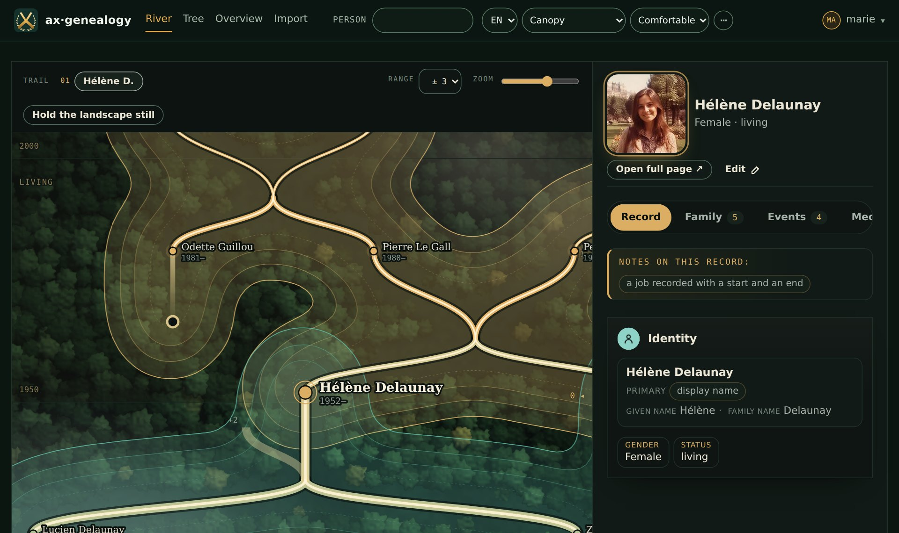](docs/screenshots/river-zoom.jpg) | [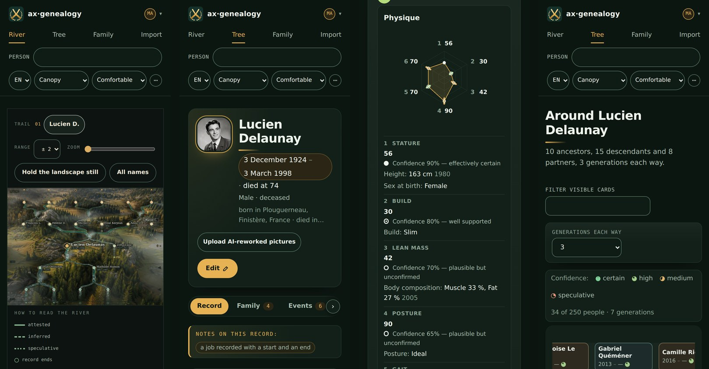](docs/screenshots/mobile.jpg) |

The river reaches 2, 3 or 5 generations each way. To zoom from 1× to 3×,
use Ctrl (⌘) and the wheel, a trackpad, two fingers, the slider, or the `+`,
`−` and `0` keys. Once zoomed in, drag to move *(new in 0.5.0)*.

### The same family as a tree, or as a galaxy

*(New in 0.5.0, on `main`.)* Two themes draw the landing page their own way.

- **Fusion** grows the family as a living tree. The person you are visiting
  stands at the foot of the trunk. Their ancestors are the roots, spreading
  under the soil, and their descendants are the crown. The living are green
  leaves at the tips, and sap climbs from the roots to the leaves.
- **Galaxy** makes that person a sun, with one orbit per generation:
  descendants above, ancestors below.

Underneath, both are the river:

- the same people, with the same marks for how sure each link is;
- the same travel, trail, zoom and keyboard;
- the same privacy: a reader sees only what they may.

Above the drawing, a dashboard counts ancestors, descendants, generations
and the living, and shows how many links are attested. **Whole family**
opens the widest range in one click.

| Fusion: a living tree, from the roots to the leaves | Galaxy: a solar system, one orbit per generation |
|---|---|
| [](docs/screenshots/fusion-tree.jpg) | [](docs/screenshots/galaxy-system.jpg) |

<p align="center">
<a href="docs/screenshots/fusion-whole.jpg">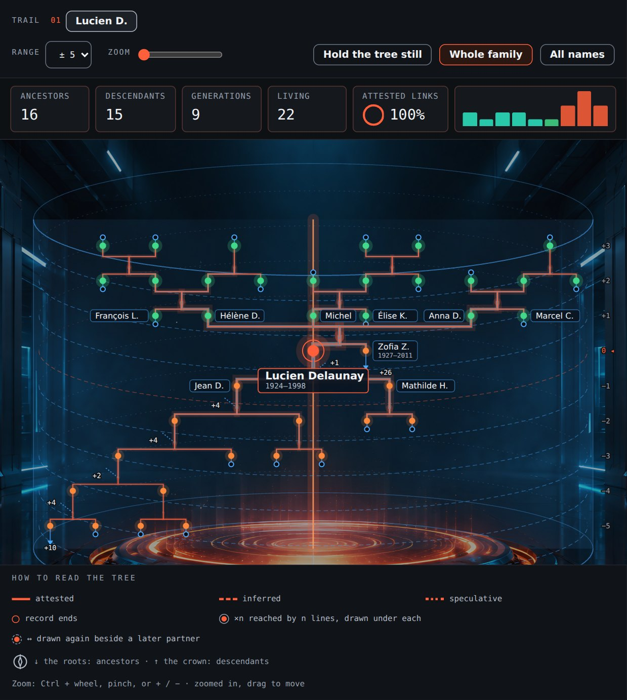</a>
</p>

### Every person, a record

| A record: portrait, dates, places, family with how sure each link is | Photographs and scanned documents, with their captions |
|---|---|
| [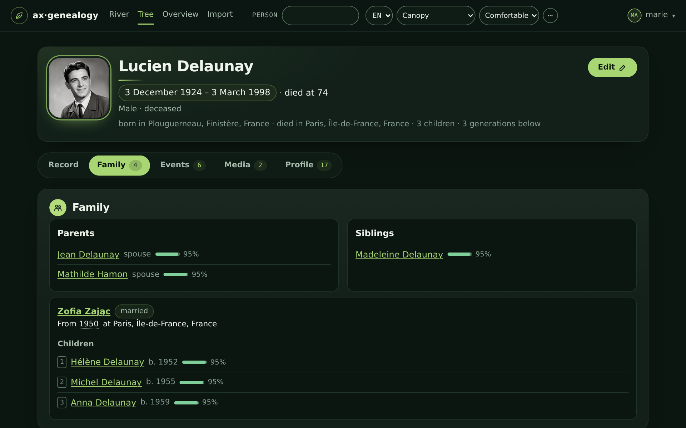](docs/screenshots/record.png) | [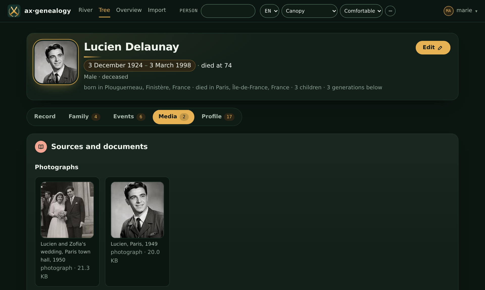](docs/screenshots/record-media.png) |

Tabs show only what the record holds: the record itself, family, events,
sources, media and a profile. Photographs get thumbnails. Certificates,
census pages, letters, gravestones and parish registers are kept with the
person they belong to.

### Charts from the record

The profile tab opens on three spider-web charts: **physique**,
**temperament and mind**, and **health and vitality**, six axes each.

[](docs/screenshots/radar-charts.png)

The charts are honest by construction:

- **No data, no axis.** An axis with nothing to read is drawn as absent, a
  dotted spoke and "none". It is never drawn at 50.
- **Every score shows its working.** Each axis lists the facts it read, with
  their dates, in your language. The rules behind each axis are written down
  in the [source](src/radar.rs), and nothing is guessed by a language model.
- **Certainty is drawn three ways at once:** a bar along the spoke as long as
  the uncertainty, a marker whose shape is the band, and the band's colour.
  No single channel carries it alone, so reading it never depends on
  telling two colours apart.
- **Nothing is stored.** The scores are a reading of the record, worked out on
  every view. Nobody can later mistake them for a claim about the person.
- **Living people are protected.** A living person's temperament chart stays
  folded, and anything a reader may not see counts as not recorded.

[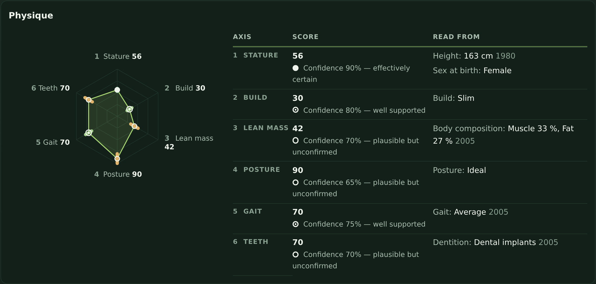](docs/screenshots/radar-physique.png)

### The tree, the overview, and what is worth a look

| The tree, generation by generation, with the record beside it | The overview: the family in figures, and how sure each parentage is |
|---|---|
| [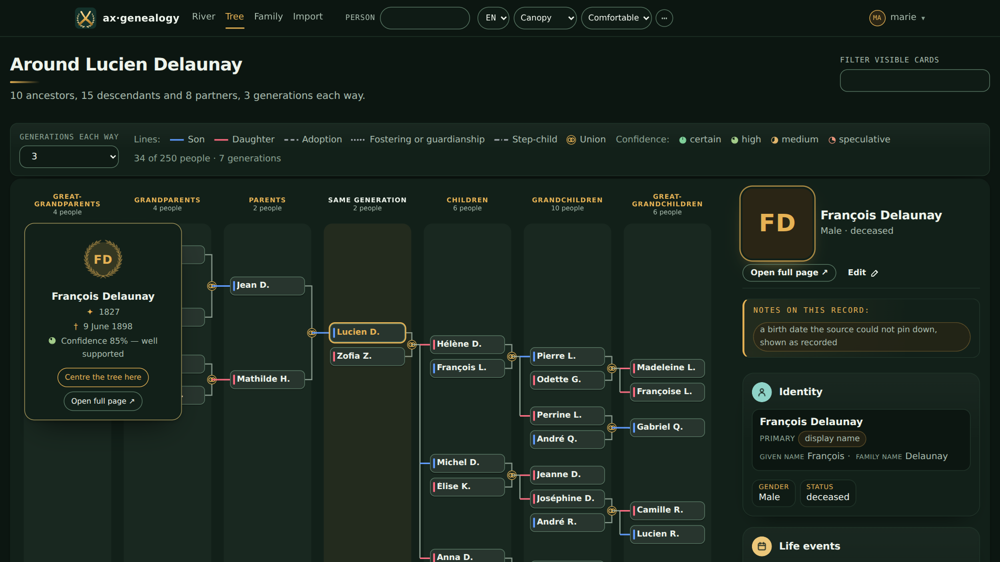](docs/screenshots/tree.png) | [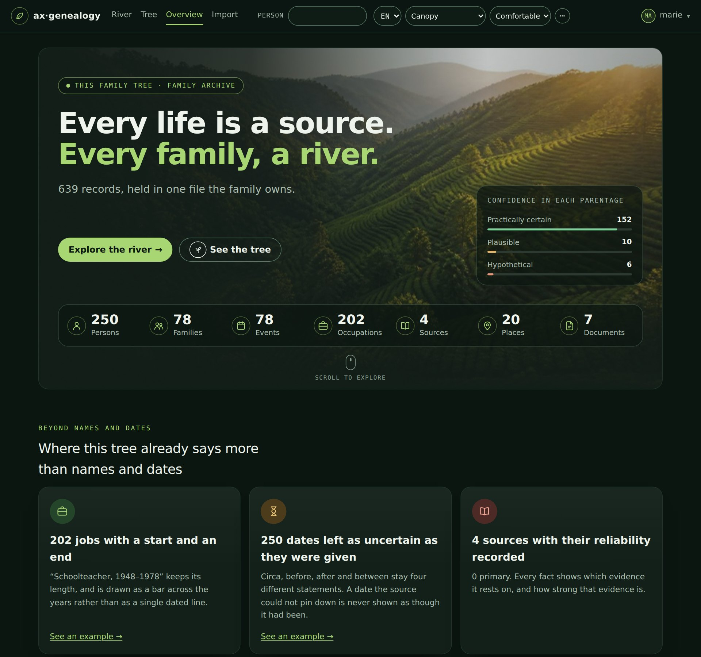](docs/screenshots/overview.jpg) |

| Things worth a look: 17 checks over the whole family | Editing: six tabs over one form, and one save |
|---|---|
| [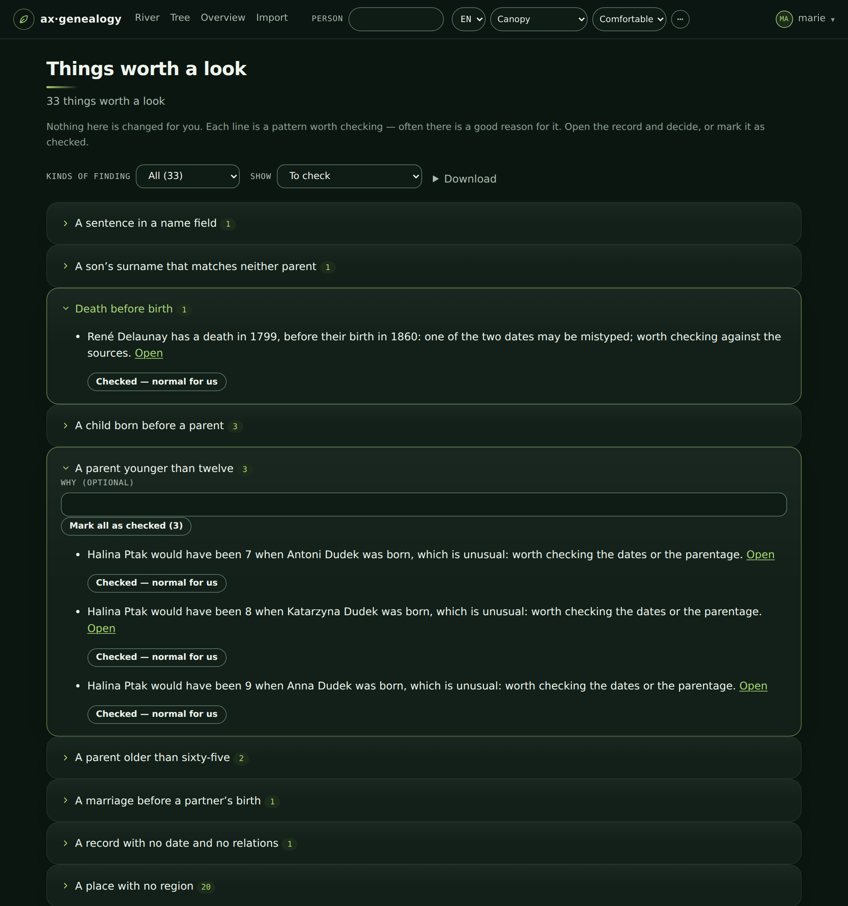](docs/screenshots/quality.png) | [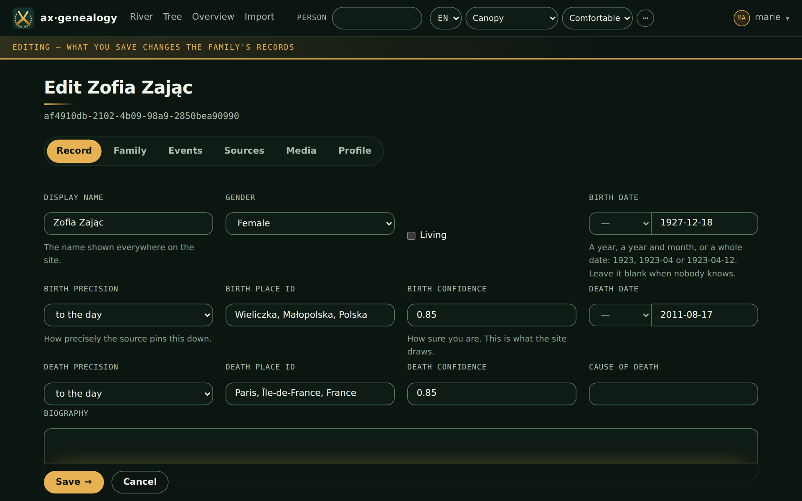](docs/screenshots/editor.png) |

The quality page changes nothing for you. It points at patterns that are
often mistakes and sometimes not: a death before a birth, a mother aged
seven, the same couple recorded twice, a place that reads like a note. You
open the record and decide, or mark the finding as checked, with a reason if
you like. The list downloads as CSV or JSON.

### First start: three ways in

*(New in 0.5.0, on `main`.)* A new installation knows when it holds no family
yet. Its administrator then finds **Set up this archive** on the overview and
on the administration page, and behind it three doors:

1. **An `.axgf` archive**, from another installation or a backup. It is
   streamed to disk, up to 4 GB, and comes in with its photographs.
2. **Nothing.** Add the first person and grow the family one record at a
   time.
3. **A GEDCOM file of any version**, as `.ged` or GEDCOM 7's `.gdz`, from
   whatever program wrote it. It is read and shown before anything is kept:
   which version and encoding it was in, what came across, and what the
   quality checks would flag. A second press keeps it.

| The three doors | A 1998 export in ANSEL, read before it is kept |
|---|---|
| [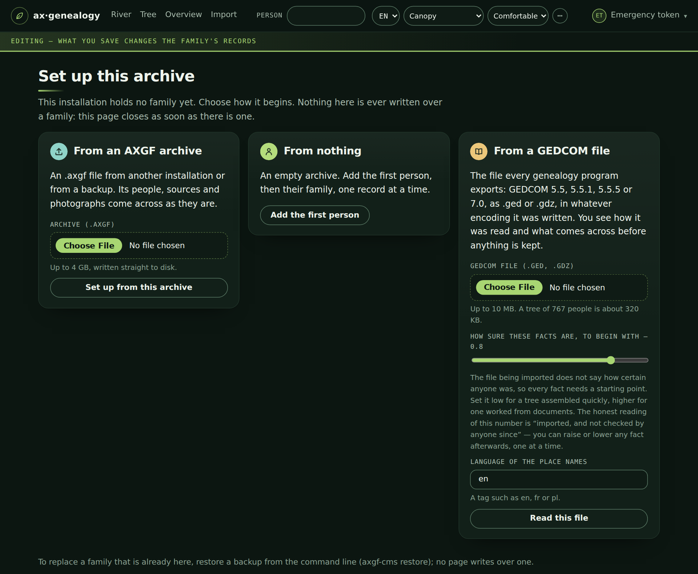](docs/screenshots/setup-doors.png) | [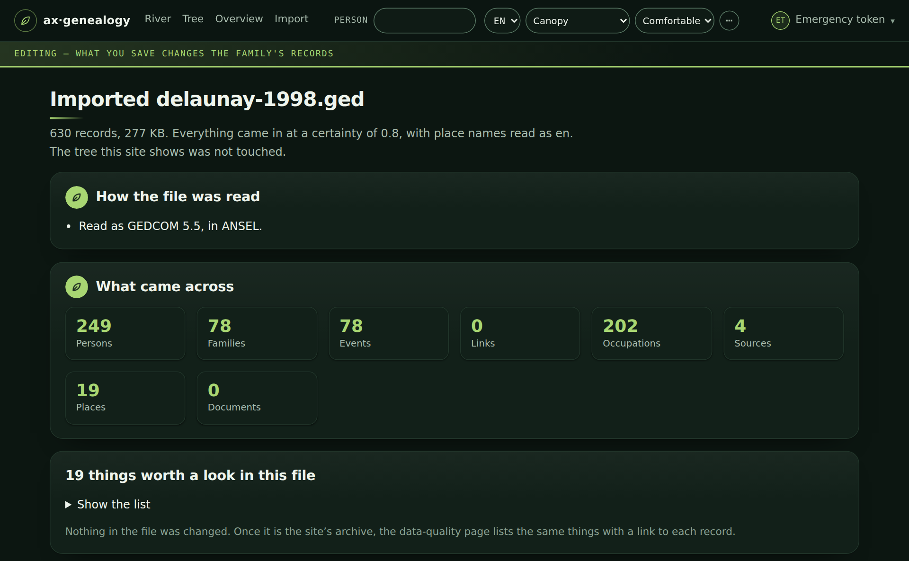](docs/screenshots/setup-gedcom.png) |

The doors close as soon as there is a family, and **no page ever writes over
one**. Replacing a family that exists stays a deliberate act on the command
line, from a backup ([`axgf-cms restore`](#backup-and-restore)). The same
GEDCOM reader is behind **Import** (`/convert`), which turns any GEDCOM into
an `.axgf` to download, without touching the site.

### Portraits reworked by an AI

On a record's masthead, beside the face, the family's signed-in members can
see up to three pictures an AI made from the person's photographs: what
they might have looked like. Each is marked "AI". None of them is ever the
person's picture, in their gallery or among the files that serve as
evidence. In the archive, each one is a Document that says what it is
([why](docs/adr/0009-ai-reworked-portraits-are-never-evidence.md)).

### Make it yours

[](docs/screenshots/theme-heroes.jpg)

There are four themes.

- **Canopy** (*Canopée*, the default from 0.5.0) is a dark forest green with
  the gold of the logo.
- **Fusion** is a dashboard at night, charcoal and neon red, and draws the
  family as a tree.
- **Galaxy** is deep space, navy and violet, and draws it as a solar system.
- **Summit** is a mountain at sunrise, night navy and the gold of first
  light. It draws the family as an ascent: the ancestors up the mountain,
  the descendants in the valley. The further back the person you stand on
  was born, the further the snow comes down, and the sun rises as you
  travel.

Each carries its own buttons, motion and photographs, and every page follows
it, down to the words: under Fusion the overview reads "Every life is a
leaf. Every family, a tree."

All four are dark. None is built for high contrast or for colour
blindness. Certainty never rests on colour alone, though: a bar's length, a
pie and the printed percentage carry it under every theme
([why there are three](docs/adr/0008-three-themes.md)).

Three styles set the density:

- **Comfortable**;
- **Compact**;
- **Paper**, a serif face and rules, for reading once or for printing.

Every reader chooses for themselves, and a signed-in reader's theme and
language follow them to every device.

### In eleven languages, right to left included

[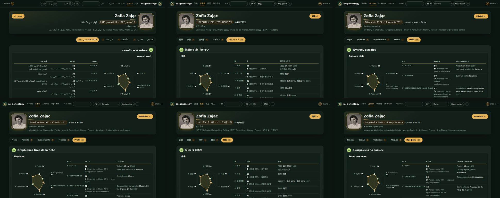](docs/screenshots/languages.jpg)

---

## What is released, and what is on `main`

The latest release is **v0.4.3**. It has the river, the record, the charts,
the tree, search, the quality page, the six-tab editor, accounts, backups and
ten of the themes.

`main` carries **0.5.0**, which is not released yet. It adds:

- the living river and its zoom;
- the Canopy theme;
- the Fusion and Galaxy themes, with the family as a living tree and as a
  solar system;
- the Summit theme, with the family as an ascent at sunrise;
- four themes in all (the ten earlier ones are retired);
- portraits reworked by an AI, beside the face, for signed-in members;
- the portrait beside the river;
- the three ways in;
- the GEDCOM reader for every version and encoding.

The installer installs releases. `--from-source` builds `main`.
[CHANGELOG.md](CHANGELOG.md) has the details, version by version.

---

## Install

On a fresh Ubuntu LTS server, as a user who can `sudo`:

```sh
curl -fsSLO https://github.com/plkarin/axgf-cms/releases/latest/download/bootstrap.sh
curl -fsSLO https://github.com/plkarin/axgf-cms/releases/latest/download/bootstrap.sh.sha256
sha256sum -c bootstrap.sh.sha256 && sudo bash bootstrap.sh --with-sample
```

The installer is the one the release ships, checked against its checksum. It
installs exactly that release. Today that is **v0.4.3**, which has the river,
search, the data-quality page (`/quality`) and Study 06's quieter, larger-type
interface, and reads AXGF 1.0 and 1.1 files.

To install a particular release, fetch the same two files from
`releases/download/<tag>/` instead of `releases/latest/download/` (v0.3.1 or
later; earlier releases shipped no installer). To build what is on `main`
instead, including everything new in 0.5.0, use `--from-source`, which needs
`cargo` on root's `PATH`. Every release, with its binaries and checksums, is
on the [releases page](https://github.com/plkarin/axgf-cms/releases).

`--with-sample` seeds a small demonstration family, so a fresh install has
something to look at. It is smaller than the family in the screenshots above.
Leave it out to start with an empty tree. At the end the script prints the
address, an administrator's username and password, and the emergency token,
**once**. Keep them.

### What the installer does

Read it first if you like: [`deploy/bootstrap.sh`](deploy/bootstrap.sh). Add
`--dry-run` and it prints every step without changing anything. In order, it:

1. Checks the machine's architecture (x86-64 or ARM64).
2. Downloads the release binary and its `.sha256`, refuses to go on if the
   checksum does not match, and installs it as `/usr/local/bin/axgf-cms`.
   (`--from-source` clones this repository and builds it instead.)
3. Creates a system user `axgf-cms` with no login shell.
4. Creates `/var/lib/axgf-cms` for the data, owned by that user.
5. Writes the settings, including a generated emergency token, to
   `/etc/axgf-cms/env`, readable only by root and the service (`0640`).
6. Creates the family file: empty, or the demonstration family.
7. Creates the first administrator account and generates its password.
8. Installs and starts three systemd units: the service itself (sandboxed,
   bound to `127.0.0.1:8080`), a **daily backup** at 03:30, and a **weekly
   check** that reads the data and the newest backup back in full.
9. Waits until the service answers `/health` with the family's data readable,
   then prints what you need to sign in.

Run it again at any time: it will not overwrite your family file, your
accounts or your token. `--uninstall` removes the service and the binary and
**never** the data.

### Then sign in

Open the address it printed and sign in with the administrator it created.
There is no web page that creates the first account, on purpose: an
installation is never left open to whoever finds it first. If you left
`--with-sample` out, the family is empty. An installation built from `main`
then offers you the [three ways in](#first-start-three-ways-in). A release
lets you add the first person. Its **Import** page converts a GEDCOM into an
`.axgf` you can download, but setting an installation up from one is new in
0.5.0.

---

## Running it

It is an ordinary systemd service:

```sh
systemctl status axgf-cms           # is it up, what is it serving, when was the last backup
sudo systemctl restart axgf-cms     # after editing /etc/axgf-cms/env
sudo systemctl stop axgf-cms        # finishes any save in progress first
journalctl -u axgf-cms -f           # what it is doing
systemctl list-timers 'axgf-cms*'   # when the next backup and check run
```

Relatives get their accounts from **Admin → Accounts**; there is no
self-registration. There are three roles: a **viewer** reads, a
**contributor** also adds and corrects (optionally within one branch of the
family), and an **admin** also manages accounts, deletes, deduplicates and
exports. [docs/FAMILY.md](docs/FAMILY.md) is a guide you can send them.
Everything else an operator needs is in [docs/OPERATOR.md](docs/OPERATOR.md).

## Where your data lives

```
/var/lib/axgf-cms/
  family.axgf        the family — the only file that matters
  family.acl         the accounts (password hashes), mode 600
  family.journal     who changed what, and when
  backups/           the daily archives
  .axgf-cms-cache/   photographs unpacked for serving; rebuilt if deleted
```

**The whole family is `family.axgf`**: every person, relationship, date,
source, scanned certificate and photograph, in one file. It is an ordinary ZIP
of JSON files with the attachments inside, so you can copy it, keep it on a
USB stick, or open it with any unzip tool, with or without this program. It is
yours: **Admin → Export** downloads it at any time.

The accounts and the edit history are deliberately *not* inside it. The family
file is made to be copied and sent to people; password hashes and a record of
who corrected what are not.

## Security: it listens on localhost only

**The service binds `127.0.0.1` and must stay there.** It speaks plain HTTP.
Exposed directly, with `--bind 0.0.0.0` and nothing in front of it, every
password typed into the sign-in form crosses the network in clear text, and a
family's private records are readable by anyone who can reach the port.

To put it on the internet, keep it on localhost and put a reverse proxy in
front that terminates TLS. Two configurations ship in
[`deploy/proxy/`](deploy/proxy/), each tested in front of a live instance:

- [`Caddyfile`](deploy/proxy/Caddyfile): Caddy obtains and renews the
  certificate itself. Replace the site name and the email, copy it to
  `/etc/caddy/Caddyfile`, reload Caddy.
- [`nginx-axgf-cms.conf`](deploy/proxy/nginx-axgf-cms.conf): for nginx with a
  certificate from certbot.

Both set the `X-Forwarded-Proto` header that makes the session cookie `Secure`,
allow uploads up to the application's own limit, and wait long enough for a
large save. [docs/OPERATOR.md](docs/OPERATOR.md#publishing-it-tls-and-a-reverse-proxy)
has the details.

Inside, passwords are hashed with Argon2id, sign-in attempts are throttled,
and the session cookie is `HttpOnly` and `SameSite=Strict`. Visibility is
enforced on the server on every read path. A person you may not read is
redacted, not omitted: they keep their place in the tree, with no name and no
dates.

**Before you publish a tree imported from GEDCOM:** GEDCOM records no privacy
settings, so an imported tree has none. Until you set them person by person,
anyone recorded as living is shown only to signed-in relatives and everybody
else is public. Check that is what you want.

## Backup and restore

Backups happen on their own: one verified archive a day, kept as 7 daily,
4 weekly and 12 monthly, in `/var/lib/axgf-cms/backups/`. Each is a plain ZIP
holding the family file, the accounts and the edit history, and is read back
in full before it is kept. To back up right now:

```sh
sudo systemctl start axgf-cms-backup.service
```

**A backup on the same disk does not survive that disk.** Copy the archives
somewhere else, for example nightly with
`rsync -a /var/lib/axgf-cms/backups/ backup@othermachine:/srv/axgf/`.

To restore, stop the service and give it an archive. What is there now is
moved aside, not deleted:

```sh
sudo systemctl stop axgf-cms
sudo -u axgf-cms axgf-cms restore --bundle /var/lib/axgf-cms/family.axgf \
  /var/lib/axgf-cms/backups/axgf-backup-20260923T200223Z.zip
sudo systemctl start axgf-cms
```

## Upgrade

```sh
curl -fsSLO https://github.com/plkarin/axgf-cms/releases/latest/download/bootstrap.sh
curl -fsSLO https://github.com/plkarin/axgf-cms/releases/latest/download/bootstrap.sh.sha256
sha256sum -c bootstrap.sh.sha256 && sudo bash bootstrap.sh --upgrade
```

It backs up first, keeps the working binary aside, installs the new one,
restarts, and checks that the family's data is readable. If it is not, it puts
the previous version back on its own. Without `--version` it upgrades to the
latest stable release.

## Languages

The site speaks eleven languages. **Two of them, English and French, have
been reviewed by someone who speaks them. The other nine (Polish, Russian,
German, Italian, Spanish, Portuguese, Chinese, Japanese and Arabic) are
complete but unreviewed:** every message is translated, and nobody has checked
them. In genealogy that matters, because the right word for a union, a
godparent or a primary source depends on each country's record-keeping
tradition. The language menu marks which is which, and
[CONTRIBUTING.md](CONTRIBUTING.md) says where to start if you can help.

---

## Opening a `.axgf` file on your own computer

*For a relative on Windows or a Mac who has been sent a family file. You do
not need a server, a proxy or a certificate.*

**The easiest way is not to run anything:** ask whoever looks after the family
site for an account, and read it in your browser.
[docs/FAMILY.md](docs/FAMILY.md) explains how. The file itself is also a
plain ZIP, so any unzip tool shows you what is inside, as text.

Running this program on your own computer is possible only on some systems
today, and it is honest to say so up front:

| Your computer | Can you run it? |
|---|---|
| **Linux** | **Yes.** Download the current release, [`v0.4.3`](https://github.com/plkarin/axgf-cms/releases/tag/v0.4.3), for x86-64 or ARM64; it opens AXGF 1.0 and 1.1 files alike. |
| **Mac** (Apple Silicon or Intel) | **Not yet, without help.** There is no Mac download. The program *builds* for both kinds of Mac, but nobody has run it on one, so it is untested. Someone with Rust installed can build it with `cargo install --git https://github.com/plkarin/axgf-cms --locked`. |
| **Windows** | **No.** It does not currently build for Windows: parts of it that check disk space and file permissions use Unix-only calls. Windows Subsystem for Linux (WSL) may run the Linux version, but that has not been tested either. |

On Linux, or on a Mac with a build, in a terminal, in the folder holding the
file:

```sh
./axgf-cms --bundle family.axgf
```

It prints an **admin token** (a long string of letters and digits) and
`listening on http://127.0.0.1:8080`. Open that address in your browser, click
**Sign in**, open the folded *emergency token* section, and paste the token.
You can now see everything in the file. Press **Ctrl-C** in the terminal to
stop. Nothing leaves your computer: it only listens on `127.0.0.1`.

**Edits you make go into `family.axgf` itself.** Keep an untouched copy of the
file you were sent.

What will not work away from the Linux server: the installer, the automatic
backups and weekly checks (they are systemd timers), and logging to the system
journal; the program writes its log to the terminal instead.

---

## Questions

**Can I get my family back out as GEDCOM?** No, and that is deliberate.
GEDCOM has nowhere to put how sure a fact is, a relationship outside the
family, the length of a job, or a date nobody could pin down, so the return
trip would quietly drop all of it. The family exports whole instead, as the
`.axgf` itself: plain JSON that any tool can read.

**Does anything leave my server?** Not unless you ask for it. It is a single
program that serves the pages, the photographs and the charts itself, with no
third-party accounts and no trackers. Two conveniences reach outside, and
both are off until you switch them on. Looking up a place's position asks a
geocoder (Nominatim, or one you run), through the server. A clickable map in
the place editor loads its tiles from the tile server you name, in the
editor's browser. `axgf-cms --help` describes both flags, `--geocoder-contact`
and `--map-tiles`.

**What if this project stops?** Your family is still a ZIP of JSON in a
[documented format](https://github.com/plkarin/axgf-spec), with your
photographs and documents inside, next to the JSON that describes them.

## Built on an open format

`.axgf` is the [Axiom Genealogy Format](https://github.com/plkarin/axgf-spec),
and every read, check and change of it goes through the
[`axgf-rs`](https://github.com/plkarin/axgf-lib) library.

## More

- [docs/OPERATOR.md](docs/OPERATOR.md): running it day to day: health, disk,
  backups off the machine, what to do when something is wrong
- [docs/DEPLOY.md](docs/DEPLOY.md): installing by hand, and the systemd units
- [docs/FAMILY.md](docs/FAMILY.md): for relatives with an account
- [docs/REFERENCE.md](docs/REFERENCE.md): every flag and route, attachments,
  accounts and roles, and how it is built
- [docs/adr/](docs/adr/): the decisions behind the river, the themes and the
  set-up, and why
- [CHANGELOG.md](CHANGELOG.md): what changed, version by version
- [CONTRIBUTING.md](CONTRIBUTING.md): development and translations

Developing: `cargo test`, `cargo clippy --all-targets -- -D warnings`,
`cargo fmt --check`.

## Licence

Apache-2.0. See [LICENSE](LICENSE).
