<p align="center"></p>

<h1 align="center">ax·genealogy</h1>

<p align="center"><strong>Every life is a source. Every family, a river.</strong></p>

<p align="center">
A private website for your family tree, run on your own server.<br>
The whole family lives in one open file you own. Relatives sign in to read it or to correct it.<br>
How sure each fact is stays in plain sight.
</p>

<p align="center">
<a href="#a-tour">Tour</a> ·
<a href="#install">Install</a> ·
<a href="#first-start-three-ways-in">First start</a> ·
<a href="#where-your-data-lives">Your data</a> ·
<a href="#security-it-listens-on-localhost-only">Security</a> ·
<a href="#more">Documentation</a>
</p>

[![The river, the landing page: Lucien Delaunay at the fixed point, his parents and grandparents flowing in from below, his children and grandchildren branching above, as winding mountain streams that meet as broader rivers, laid in perspective on a mountain valley seen from the air at golden hour: forest, meadows where red deer graze, granite outcrops, mist in the distance. The streams narrow toward the distance and run in clearings through the forest, trees leaning over their banks, and white water rises where two streams meet. His record is open beside it with his portrait.](docs/screenshots/river-hero.jpg)](docs/screenshots/river-hero.jpg)

<sub>Every screenshot on this page shows the same fictional family: about 250
people from Brittany and Poland, from the 1640s to today. It was generated
for the purpose, and its portraits are generated images. None of these people
existed.</sub>

*(The site calls itself **ax·genealogy**. The repository, the binary, the
service and its system user are all `axgf-cms`.)*

**Who this is for.** Someone in the family who is comfortable running a Linux
server, a VPS or a machine at home, and wants to host the tree for everybody
else. Most of this page is for them. **If you have been sent a `.axgf` file
and just want to look at it, skip to
[Opening a `.axgf` file on your own computer](#opening-a-axgf-file-on-your-own-computer).**

---

## Why ax·genealogy

- **Your family is one file that you own.** People, relationships, dates,
  sources, scanned certificates and photographs all live in `family.axgf`. It
  is an ordinary ZIP of JSON in an [open format](https://github.com/plkarin/axgf-spec),
  so it still opens long after this program is gone. **Admin → AXGF bundle**
  downloads it at any time, as it is or encrypted to an OpenPGP key.
- **Doubt is part of the record.** Every fact and every parent–child link
  carries how sure it is. The site draws it everywhere: the river's lines are
  solid, dashed or dotted, the tree's cards carry a certainty mark, and every
  chart shows its confidence. A date stays as uncertain as it was given: *circa*,
  *before*, *between*.
- **Private where it should be.** Living relatives are shown only to people
  who are signed in, while their great-grandparents can be public. A living
  person's health, biometrics, genetics and legal records are open to
  administrators only, and any of these can be closed further, person by
  person. All of this is enforced on the server, on every page, photograph
  and download.
- **Relatives help.** You create their accounts and choose what each may do:
  read, correct, or administer. A contributor can be limited to one branch.
  Every change records who made it and when.
- **Any GEDCOM comes in** *(new in 0.5.0; earlier releases read GEDCOM 5.5.1)*. It
  reads GEDCOM 5.5, 5.5.1, 5.5.5 and 7.0, in ANSEL, UTF-8, UTF-16,
  Windows-1252 or Mac Roman. Before anything is kept, it shows you how the
  file was read and what came across.
- **It looks after itself.** One binary, one installer, a verified backup
  every day and a full read-back check every week. Upgrades roll back on
  their own if the new version cannot read your family.

---

## A tour

### The river

The landing page puts one person at the fixed point. Their ancestors flow in
from below, like the sources of a river, and their descendants branch out
above toward the living. Each line is as wide as the descendants it carries,
and its stroke says how sure the link is: solid when attested, dashed when
inferred, dotted when speculative. Click anyone to travel to them. The trail
at the top numbers where you have been, and the record beside the river
follows you.

<p align="center">
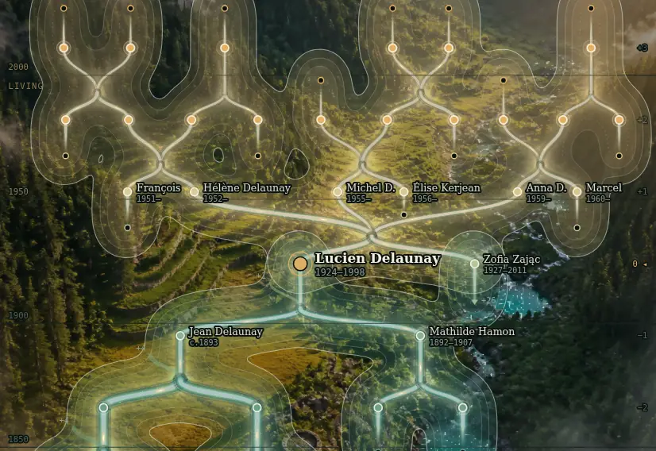
</p>

**The river is alive** *(new in 0.5.0)*. Under the drawing lies a
mountain valley seen from the air at golden hour — forest, meadows, larches
turning gold, granite outcrops, a bed of pale sand: a 4K picture drawn in
relief by WebGL, so it stays sharp. Its only water is the family's, and it
lies on the valley's ground at the picture's own angle, 60° from straight
down: narrower and flatter toward the distance, its banks seen sideways.
Each parent's line is a small winding mountain stream over stones, with
foam and small falls. Where two parents' streams meet, the line to their
child becomes a broader, calmer river: it starts under a fall, its spray
rising, or in a still pool, or down rapids. Every bank is its own, with
pools, bars of gravel in the bends, and boulders breaking the water. The
water belongs to its valley: it clears its way through the forest, the
trees of the near bank lean over it, it takes the colours and the light
around it, runs white over rock and fades into the haze in the distance.
No two courses wind alike. An
inferred link runs underground and out again, and a speculative one is a
trail of pools.

The valley lives too: the wind runs through its trees and in waves over its
meadows, clouds cross it with their shadows, herds of red deer, wild horses,
chamois and ibex graze and wander on their own ground, an eagle circles and
birds pass. A ring of light opens on the ground around each person, and the
pointer leans the landscape a little. It holds still for readers who ask
their system for less motion, and with the river's own pause button.
Nothing moves while the river is off screen.

| Zoom in, and the names keep their size, as on a map | On a phone: the river, a record, its charts, the tree |
|---|---|
| [](docs/screenshots/river-zoom.jpg) | [](docs/screenshots/mobile.jpg) |

The river reaches 2, 3 or 5 generations each way. To zoom from 1× to 3×,
use Ctrl (⌘) and the wheel, a trackpad, two fingers, the slider, or the `+`,
`−` and `0` keys. Once zoomed in, drag to move *(new in 0.5.0)*.

### The same family as a tree, a galaxy, an ascent, a funnel or a tree to climb

*(New in 0.5.0.)* Five themes draw the landing page their own way.

- **Fusion** grows the family as a tree in tiers inside a glass cylinder, on
  the projector of a laboratory. The person you are visiting stands on the
  axis. Their descendants climb the glass a floor per generation and their
  ancestors go down it as roots, joined by branches drawn at right angles
  as on a family chart. The branches up are green and the ones down are
  orange. The glass turns as you travel.
- **Galaxy** makes that person a sun, with one orbit per generation, over
  a spiral galaxy. The descendants are above, on violet filaments, and the
  ancestors below, on white ones. Every star holds a field that grows with
  its descendants.
- **Summit** is an ascent at sunrise over a photographed mountain: the
  ancestors in the valley, the descendants climbing toward the summit, and
  the snow coming further down the more recently the person was born.
- **Clarity** is a funnel of glass rings over a prism of light: one ring
  per generation, the oldest at the narrow end below and the newest at the
  wide mouth above. Each generation's people are pearls spread along their
  ring, family by family, and every parentage is a fine thread from one
  ring to the next. Every name is on a small frosted label, never across an
  outline. Each ring says how many people it holds, as the stages of a
  funnel chart do, and the page around it is frosted glass.
- **Genealogy** is an old tree growing out of a parchment scroll, drawn in
  relief and seen close: the person you are visiting sits on its trunk,
  their descendants up in its crown of gold leaves and their ancestors among
  its roots, joined by fine lines as on an old family chart. Travelling to
  someone climbs the tree to them, or goes down to the roots.

Underneath, all five are the river:

- the same people, with the same marks for how sure each link is;
- the same travel, trail, zoom and keyboard;
- the same privacy: a reader sees only what they may.

Above the drawing, a dashboard counts ancestors, descendants, generations
and the living, and shows how many links are attested. **Whole family**
opens the widest range in one click.

| Fusion: a tree in its glass, a floor per generation | Galaxy: a solar system, one orbit per generation |
|---|---|
| [](docs/screenshots/galaxy-system.jpg) |
| **Summit: an ascent, the oldest in the valley** | **Clarity: a funnel, the oldest at the narrow end** |
| [![The Clarity theme, light: a funnel of glass rings, pale blue at the wide mouth to pink at the narrow end, set apart from one another over a prism of violet, blue, pink and orange light. On each ring the generation's people are pearls spread evenly along its front, joined from ring to ring by fine indigo threads; the names are on small frosted labels on the rings' glass, none across an outline, and Lucien Delaunay's own label reads "Lucien Delaunay · 1924–1998". Each ring is numbered on the right on a thread: 6, 10, 6, 2, 2, 4. His record is open beside it.](docs/screenshots/clarity-funnel.jpg)](docs/screenshots/clarity-funnel.jpg) |
| **Genealogy: a tree to climb, the oldest at the roots** | **The whole family, under Fusion** |
| [](docs/screenshots/fusion-whole.jpg) |


### Every person, a record

| A record: portrait, dates, places, family with how sure each link is | Photographs and scanned documents, with their captions |
|---|---|
| [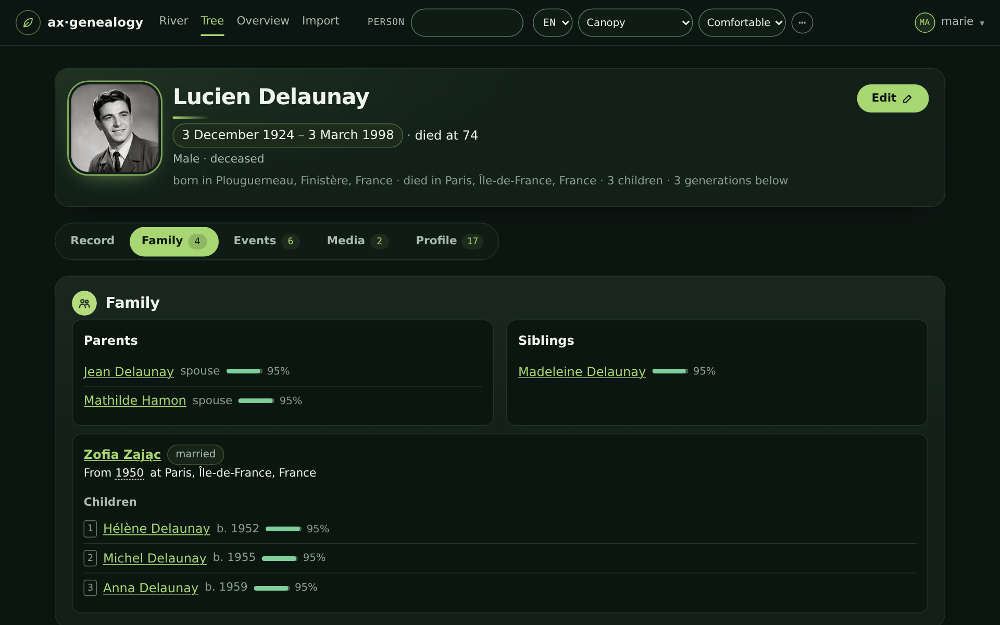](docs/screenshots/record.png) | [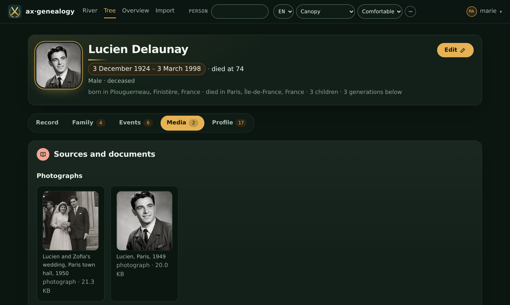](docs/screenshots/record-media.png) |

Tabs show only what the record holds: the record itself, family, kinship,
events, sources, media and a profile. Photographs get thumbnails.
Certificates, census pages, letters, gravestones and parish registers are
kept with the person they belong to.

### How two people are related, and every relative

| Kinship: how two people are related, step by step, and every relative | Ties of rite and custom, apart from the family and dotted |
|---|---|
| [](docs/screenshots/kinship.png) | [](docs/screenshots/rites.png) |

A record with any family or tie of rite has a **Kinship** tab, and so does
the record that opens beside the river. It holds two tools.

- **How are they related?** Choose anyone of the family in the list. The
  answer gives the word ("second cousin", "first cousin of the father",
  "wife of a half-nephew", "godmother"), whose relative that is, the
  ancestors the two share, the link step by step from one to the other, and
  the degree of kinship. Two people related in more than one way get every
  way, the closest first: an aunt who is also a godmother is both, aunt
  first.
- **Every relative**, by group: partners, ancestors, descendants, brothers
  and sisters, uncles and aunts, nephews and nieces, cousins, family by
  marriage, stepfamily, fostering and guardianship, rite and custom, and
  those the records connect otherwise. Each line gives the relative's
  years, the word, any other way they are related, and *Show the link*.

The tree says it too. An open card says what that person is to the one in
the middle of the tree, and the side panel adds *The link, step by step*.

How the words are worked out:

- **Descent** counts birth and adoption. Two people who share a couple are
  full siblings; one shared parent makes them half-siblings, and the
  children of half-siblings half-cousins. The children of one family are
  brothers and sisters even when nobody recorded their parents. An adopted
  child is a child, said "adoptive" where it matters.
- **Cousins** are counted by the generations up to the ancestors they
  share: first, second, third cousins, *once removed* when one of the two
  is a generation further down. A language that says it its own way gets
  its own words: French has *cousine issue de germain* for a second
  cousin, and *fils d'une cousine issue de germain* for her son.
- **A union** makes in-laws: a partner's relatives, and a relative's
  partner. A union that ended in divorce, separation or annulment gives a
  former husband or wife.
- **A stepparent, a foster parent or a guardian** the family records for
  the child (its `lineage`, AXGF 1.1) is named as such, never as a parent
  by birth. A parent's partner who is not a parent is a stepparent by
  marriage.
- **The degree** is the civil one: the generations up to the shared
  ancestor plus the generations down.
- When the records tie two people in no way that has a name, the tab gives
  the chain of facts that connects them.
- Someone a visitor may not see keeps their place in a path, as "a person
  you may not see", and is never named.

The words agree in each of the fourteen languages with whatever the
language needs: the sex of each person, the side of the family, the elder
or the younger, the parent a half-sibling shares. English and French were
written by hand; the other twelve are complete and unreviewed
([Languages](#languages)).

### Ties of rite and custom

A godparent ties a child to another family. Many traditions make ties of
that kind, and the archive records them **apart from the family**: they
never make anyone a parent, and they are drawn **dotted**, in a colour no
family line uses. On the record they have a section of their own, *Rite
and custom*, one dotted frame for each tie, with the tradition's own words
where it has them (кум, κουμπάρος, أخت من الرضاعة, 干爹, ndoyi). On the
tree a dotted curve joins two people who are both drawn, and the legend
says what it is.

There are 27 ties in ten traditions:

| Tradition | Ties |
|---|---|
| Christian | godparent (as the record states it); godparent at a baptism; sponsor at a confirmation or chrismation; sponsor of a marriage |
| Orthodox Christian | kum (kumstvo binds two families); koumbaros |
| Hispanic and Filipino | padrino and madrina; compadrazgo, the bond between a child's parents and the child's godparents; ninong and ninang |
| Jewish | the sandek, who holds the child at the brit milah; the kvatter, who carries the child in |
| Islamic | milk kinship: a milk mother, and milk siblings, a family in Islamic law that forbids marriage as birth does; kafala, raising a child without the filiation of an adoption |
| South Asian | rakhi; guru and disciple |
| East Asian | gan qin, godparents taken to protect a child; sworn siblings (jiebai); the name-giver (nazuke-oya); the nakōdo, who arranged and witnessed a marriage |
| African | namesakes (ndoyi, somo), a bond of gifts and care; initiation; the blood pact |
| Indigenous and Pacific | hānai, raised as their own by Hawaiian custom; hunka, made a relative in the Lakota ceremony |
| Civil and secular | civil godparenthood; legal guardianship |

**To record one**, open the person's editor and, in its Family tab, choose
*Edit links*. Under *A new link*, choose the other person and a *Rite or
custom*. The list is
grouped by tradition, and each choice says what this person is to the
other: *Baptism: godparent*, *Baptism: godchild*. Choosing one fills in
the kind of tie and the words both ways. Words typed in *What it is*, the
record's own, are kept instead.

**In the file**, each tie is an ordinary AXGF 1.1 Link: the nearest
`relation` the format names (`godparent`, `godchild`, `guardian`, `ward`,
`mentor`, `apprentice`, `witness` or `other`), its `category`, the words in
`label` and `label_reverse`, and `bidirectional` for a tie that runs both
ways. The rite itself is kept in `extensions["axgf-cms:kinship/v1"]`:

```json
{ "rite": "baptism", "sponsor": "from" }
```

`sponsor` says which end of the Link is the godparent or sponsor; a mutual
tie (milk siblings, compadres, namesakes) has none. Any other AXGF reader
still sees a godparent, a guardian or the words, so nothing is lost on the
way. Proposal 0002 in
[axgf-spec](https://github.com/plkarin/axgf-spec/tree/main/proposals) asks
AXGF 1.2 to name these ties itself, and the spec's
[KINSHIP.md](https://github.com/plkarin/axgf-spec/blob/main/KINSHIP.md)
explains to any other program how relationships are read from a bundle.
The decisions are in
[ADR 0020](docs/adr/0020-kinship-and-the-ties-of-rite.md), and the guide
for the family explains the tab in plain words
([docs/FAMILY.md](docs/FAMILY.md#how-are-we-related)).

Two limits. A tie of rite is drawn as a line on the tree only when both
people are on it; otherwise the open card lists it. The river views do not
draw ties of rite.

### Polygamous unions

A polygamous union is never read as a couple writ large. The archive reads
it as **one marriage per spouse** (AXGF 1.0 §4.2.2):

- **The person at the centre** is married to each of the others. The
  others are not married to one another: they are each other's
  **co-wives** (or co-husbands).
- **Each marriage has its own dates and its own end**, so one wife can be
  divorced while the others are not.
- **Each child belongs to their own mother's marriage.** The children of
  two wives are half-brothers and half-sisters. A child whose mother the
  record does not name is a brother or a sister of the others, and the
  archive never says whether full or half.

On the record, each marriage is its own block, framed with a double rule,
and a wife's block names her co-wives. On the tree, the bracket of each
marriage has a long-and-short pattern and its knot three rings, and the
legend says so. In the record editor's Family tab, a union typed
*polygamous* asks two more things: who is **at the centre of the union**,
and, for each child, the **other parent**.

In the file, the union lists everyone in `persons`. It names the person at
the centre in `primary_person_id` and each spouse's own marriage in
`unions[]`, as the specification's own example does, and each child's
parents in `parent_ids`. A household recorded as one family per marriage,
as GEDCOM records it, reads the same when each is typed `polygamous`.
[ADR 0021](docs/adr/0021-polygamous-unions.md) has the details, and axgf-spec's
proposal 0003 asks AXGF 1.2 to define these fields.

### The family's emblem

| The archive's emblem, at the head of every page and on the overview | A family's emblem, beside its union on the record |
|---|---|
| [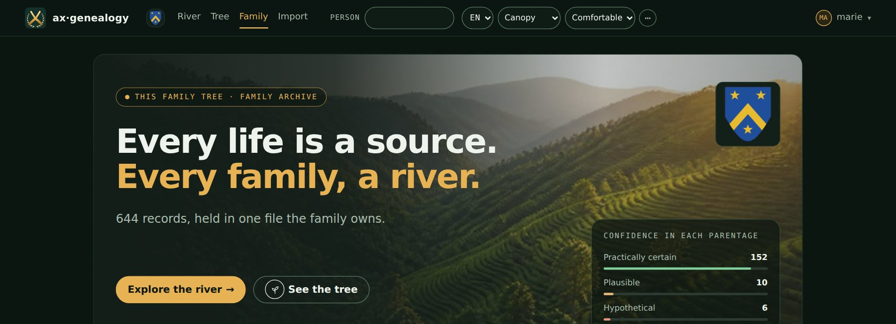](docs/screenshots/emblem-archive.jpg) | [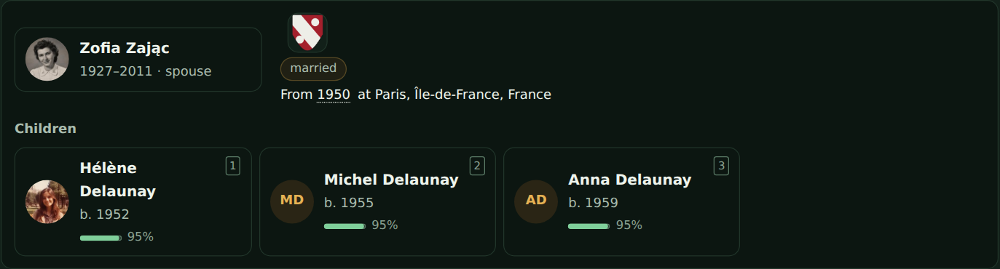](docs/screenshots/emblem-family.png) |

**The archive** can have a coat of arms, or any picture that stands for the
family it is about. It shows at the head of every page, beside the name of
the application, and above the family's name on the overview, for every
visitor. An administrator sets it in *Administration → Archive*, with
*Emblem or coat of arms of the family*.

**Each family the archive records** can have its own emblem too. It shows
beside the union on every record and on the couple's knot in the tree, to
whoever may see that family's people. It is set in the record editor's
Family tab, with *Emblem or coat of arms* on the union.

Both pages work like a person's picture. You can choose a picture already
there, add one and use it at once, or choose *No emblem*. An emblem is shown whole, because a coat of arms is a whole shape.
[ADR 0022](docs/adr/0022-family-emblems.md) has the details, and axgf-spec's
proposal 0004 asks AXGF 1.2 for a `coat_of_arms` document type and an
emblem in the manifest.

### Charts from the record

The profile tab opens on three spider-web charts: **physique**,
**temperament and mind**, and **health and vitality**, six axes each.

[](docs/screenshots/radar-charts.png)

The charts are honest by construction:

- **No data, no axis.** An axis with nothing to read is drawn as absent, a
  dotted spoke and "none". It is never drawn at 50.
- **Every score shows its working.** Each axis lists the facts it read, with
  their dates, in your language. The rules behind each axis are written down
  in the [source](src/radar.rs), and nothing is guessed by a language model.
- **Certainty is drawn three ways at once:** a bar along the spoke as long as
  the uncertainty, a marker whose shape is the band, and the band's colour.
  No single channel carries it alone, so reading it never depends on
  telling two colours apart.
- **Nothing is stored.** The scores are a reading of the record, worked out on
  every view. Nobody can later mistake them for a claim about the person.
- **Living people are protected.** A living person's temperament chart stays
  folded, and anything a reader may not see counts as not recorded.

[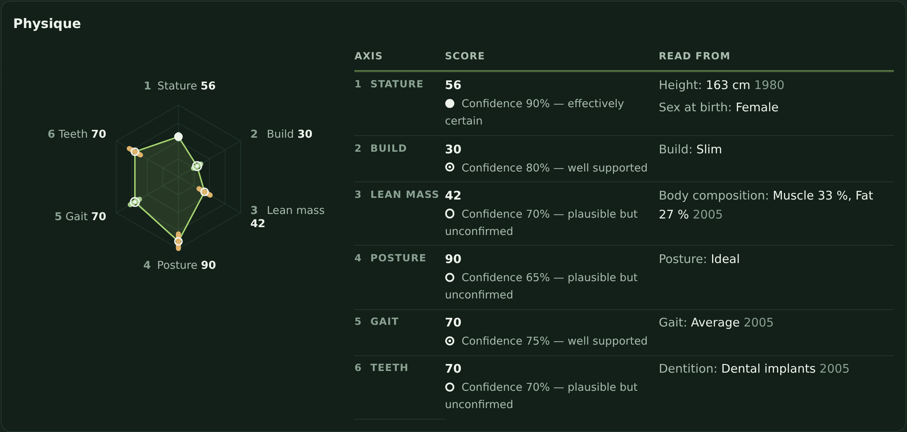](docs/screenshots/radar-physique.png)

### The tree, the overview, and what is worth a look

| The tree: a family chart read down the page, its lines in the children's colours | The overview: the family in figures, and how sure each parentage is |
|---|---|
| [![The tree page around Lucien Delaunay as a classic family chart read down the page, one column per generation: his great-grandparents, grandparents and parents in the columns to his left, his children, grandchildren and great-grandchildren to his right, each column named at its head (Grandparents, Parents, Same generation, Children). Each couple is joined by a grey bracket with a knot of two rings, and a grey comb leads to their children, the line to each son blue and to each daughter red; a legend in the bar above explains the lines. Each compact card shows a first name and an initial beside a blue or red strip. His great-grandfather's card is open over its neighbours, with his initials in a laurel ring, his full name, his dates, how sure his birth is, and the buttons "Centre the tree here" and "Open full page"; that ancestor's record is beside the chart.](docs/screenshots/tree.png)](docs/screenshots/tree.png) | [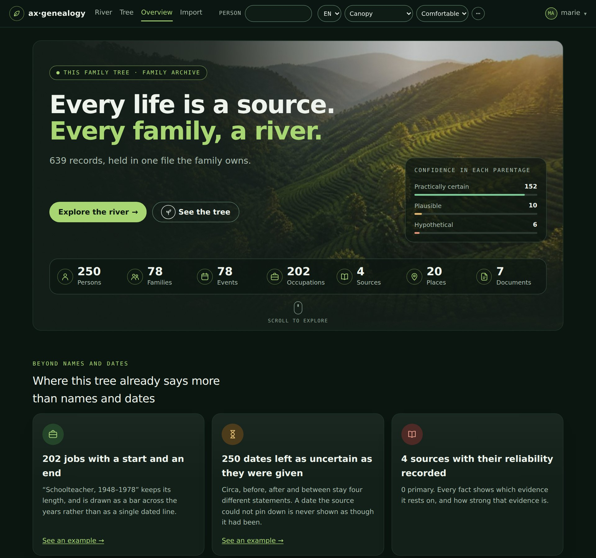](docs/screenshots/overview.jpg) |

| Things worth a look: 17 checks over the whole family | Editing: six tabs over one form, and one save |
|---|---|
| [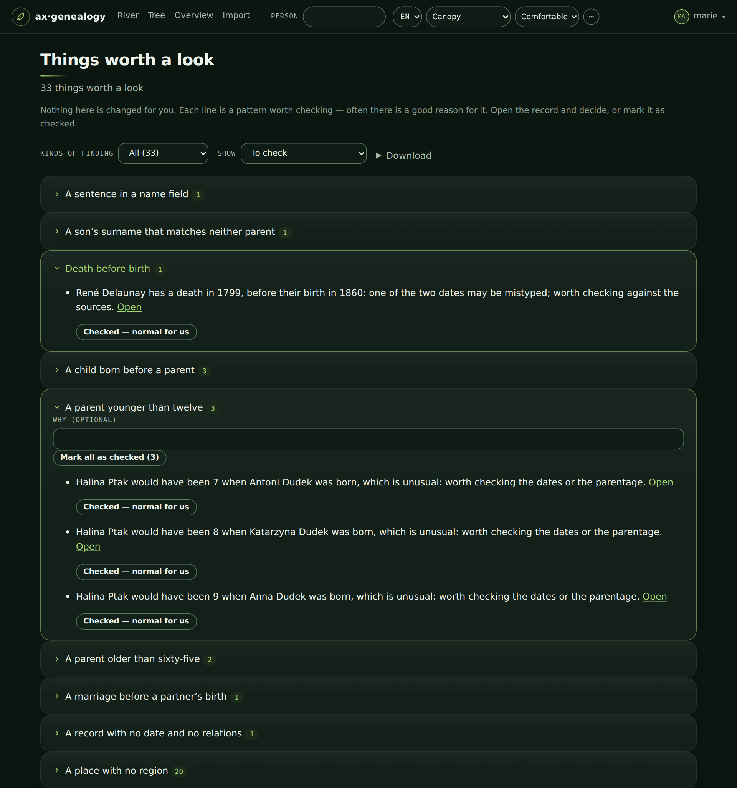](docs/screenshots/quality.png) | [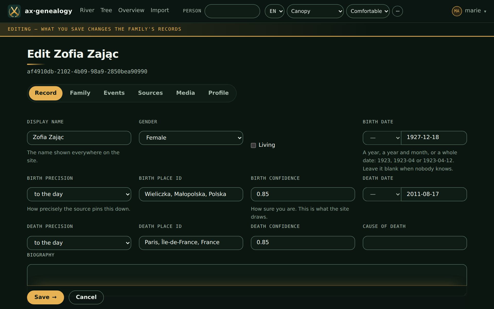](docs/screenshots/editor.png) |

The quality page changes nothing for you. It points at patterns that are
often mistakes and sometimes not: a death before a birth, a mother aged
seven, the same couple recorded twice, a place that reads like a note. You
open the record and decide, or mark the finding as checked, with a reason if
you like. The list downloads as CSV or JSON.

### First start: three ways in

*(New in 0.5.0.)* A new installation knows when it holds no family
yet. Its administrator then finds **Set up this archive** on the overview and
on the administration page, and behind it three doors:

1. **An `.axgf` archive**, from another installation or a backup. It is
   streamed to disk, up to 4 GB, and comes in with its photographs.
2. **Nothing.** Add the first person and grow the family one record at a
   time.
3. **A GEDCOM file of any version**, as `.ged` or GEDCOM 7's `.gdz`, from
   whatever program wrote it. It is read and shown before anything is kept:
   which version and encoding it was in, what came across, and what the
   quality checks would flag. A second press keeps it.

| The three doors | A 1998 export in ANSEL, read before it is kept |
|---|---|
| [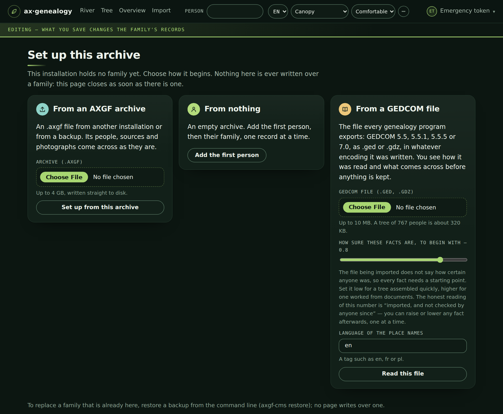](docs/screenshots/setup-doors.png) | [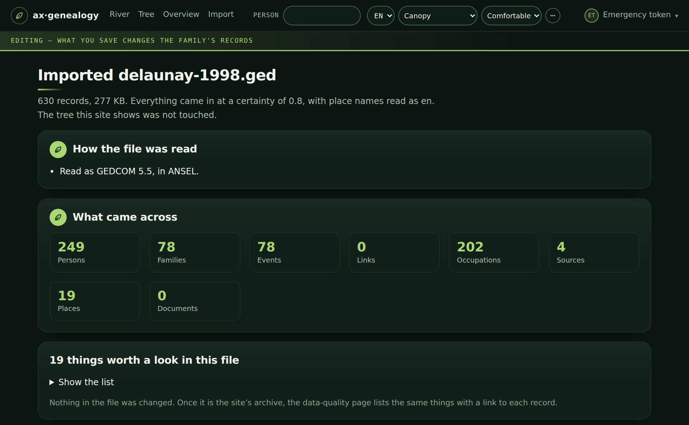](docs/screenshots/setup-gedcom.png) |

The doors close as soon as there is a family, and **no page ever writes over
one**. Replacing a family that exists stays a deliberate act on the command
line, from a backup ([`axgf-cms restore`](#backup-and-restore)). The same
GEDCOM reader is behind **Import** (`/convert`), which turns any GEDCOM into
an `.axgf` to download, without touching the site.

### Portraits reworked by an AI

On a record's masthead, beside the face, the family's signed-in members can
see up to three pictures an AI made from the person's photographs: what
they might have looked like. Each is marked "AI". None of them is ever the
person's picture, in their gallery or among the files that serve as
evidence. In the archive, each one is a Document that says what it is
([why](docs/adr/0009-ai-reworked-portraits-are-never-evidence.md)).

### Run it from the browser: the administration console

*(New in 0.5.0.)* An administrator finds six rooms behind one
strip. The overview opens on a tile for each of the five others, with what
each would say first.

| Infrastructure: health, version, storage and computing | The AXGF bundle: conformity, anomalies, export |
|---|---|
| [](docs/screenshots/console-infrastructure.jpg) | [](docs/screenshots/console-bundle.jpg) |

- **AXGF bundle.** How the family's file conforms to AXGF 1.1, each finding
  green, a warning or critical, and opening on what to do about it: the
  format, the manifest, validation, the attached files, whether the accounts
  were made for this family, anyone living who is visible to visitors, and
  the open questions of the quality page. Below, the **export**: the file as
  it is, or **encrypted to someone's OpenPGP key** (`family.axgf.gpg`,
  AES-256), which only they can open with `gpg --decrypt`. A key too weak
  (RSA under 2048 bits), expired or revoked is refused, and the page says
  whether a key is in the FIPS-approved set.
- **Infrastructure.** Eighteen checks run each time the page opens, the same
  questions a careful review would ask: is the site reached over HTTPS, who
  can administer it, is the emergency token still set, are there backups and
  room for the next ones (with the growth measured from them), how much
  memory is left under the service's ceiling, is a newer version out, is the
  sandbox in place, is the clock right. Each is green, a warning or critical,
  with its plan, and the same checks are served as JSON for a monitor. Then
  the **version**: the one running, the ones published, and a button to
  install another — a newer one, or an older one if you type its tag twice.
  The button asks a small helper that runs as root outside the web service,
  which does exactly what `bootstrap.sh --upgrade` does: backup, checksum,
  restart, health check, and the previous version back on its own if the
  new one does not answer. Then **storage** (the partition, what the site
  keeps on it, how fast it grows, how many days of room are left) and
  **computing** (system, processor, load, memory).
- **Accounts.** Who may do what, at a glance, and how each account signs in.
- **Connectivity.** The site's public address, the sign-in rules and the
  sign-in services (below).
- **AFG.** The Artificial family genealogist: where its computing comes
  from, and a test (below).

### The Artificial family genealogist (AFG)

*(New after 1.0.0: the first part.)* An agent that reads the family's
archive and answers about it. It draws on two kinds of knowledge:

- **The archive** is what it knows of the family.
- **A brain**, one for each account that talks to it, is what it remembers
  of that person.

This first part sets where its computing comes from, in the administration's
AFG room, and tests it. The second part will bring it to the pages, one use
at a time.

<p align="center">
<a href="docs/screenshots/afg-room.jpg"></a>
</p>

There are five ways, and each is spoken to in its own way:

| Way | What you fill in |
|---|---|
| An address: **Ollama** | The address (`http://127.0.0.1:11434` unless you say otherwise) and, if you like, a model. |
| An address, an API key and a model: **OpenAI**, **Mistral**, **vLLM**, **Claude** (the Anthropic API), **Gemini** | The usual address is already there. The key is kept with the accounts and never shown again. |
| A coding agent already signed in on this machine: **Claude Code**, **Codex**, **OpenCode** | A model; an effort in the agent's own words (`low` to `max`, `minimal` to `xhigh`, a variant); and the program, which the room finds by itself. |

**The test** sends the archive as it is: every JSON file of the `.axgf`,
without the photographs. It asks "Give me the top 3 families with the most
declared individuals" (in French, *Donne-moi le top 3 des familles disposant
du plus grand nombre d'individus déclarés*). An empty archive is answered
*Empty bundle* (*Bundle vide*). The result opens in a window over the room:
**success**, with the answer drawn from its Markdown, the model and the
tokens read (Claude Code also reports its cost), or **error**, with what the
service or the agent said.

**Each account's brain** is a folder on disk, `family.brains/<username>/`,
beside the archive, readable by the service only:

- `memory.md` holds what the AFG chose to remember of the person, one fact a
  line.
- `conversations.jsonl` holds every exchange.

The AFG reads the asker's brain after the archive, and asks to remember
something by ending its answer with a `<memory>` block. The block is taken
out of what is shown, and the window says what was kept. A test is an
exchange like any other: the first one makes the administrator's brain.

**Who may talk to the AFG** is a yes or no for each account, on the Accounts
page, and is off until you tick it. The test in the AFG room is an
administrator's check of the setup and does not ask for it.

Before you press it:

- **Living people's records are sent too**, to wherever the computing runs.
  Health, biometrics, genomics, legal records and behaviour stay out unless
  you tick them in.
- **An agent reads the archive and nothing else.** Claude Code runs without
  any tool. Codex runs without a shell. OpenCode has every tool denied but
  reading its own folder.
- **The installed service reaches only this machine.** A model on the
  internet, or an agent, needs the operator to open the way
  ([how](docs/OPERATOR.md#the-afg-where-its-computing-runs)).

Why it works this way: [where the computing comes from](docs/adr/0023-the-artificial-family-genealogist.md),
[the brains, the window and who may talk to it](docs/adr/0024-the-afgs-brains.md).

### Let the family in: registration and sign-in services

*(New in 0.5.0.)* You choose, on the Accounts page, whether
relatives can open an account themselves:

- **administrators only** (the default: you create every account);
- **with the family's secret**, a phrase you pass on like a door code, which
  you can draw again at any time;
- **open to visitors**.

An account opened this way is a member's: it reads what members read and
changes nothing, until you give it another role.

<p align="center">
<a href="docs/screenshots/register.jpg">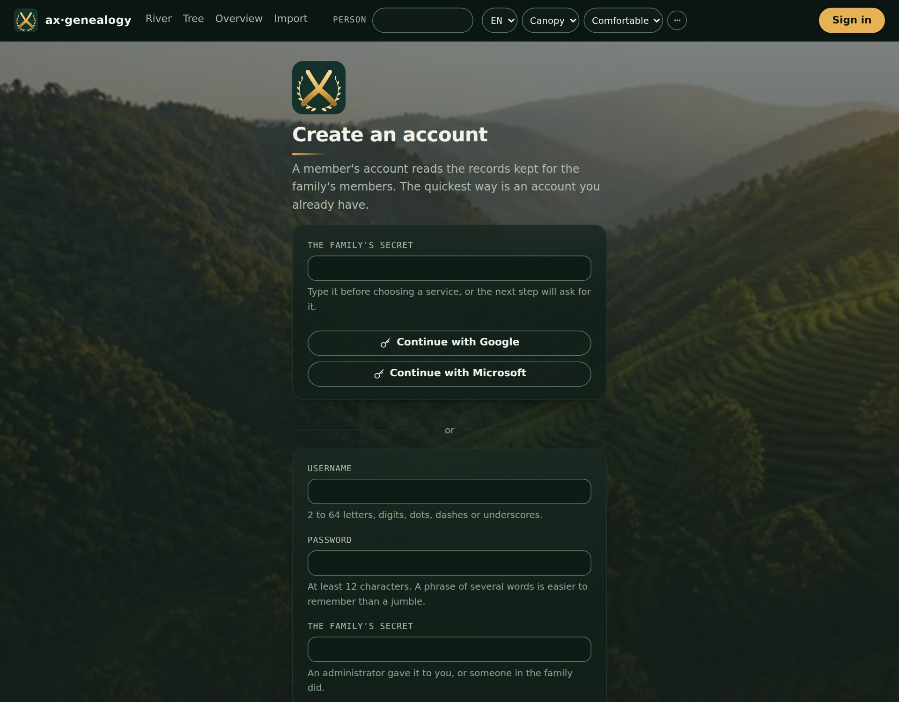</a>
</p>

The quickest way in is an account a relative already has. Under
**Connectivity**, register the site with **Google**, **Microsoft**,
**GitHub** or any **OpenID Connect** provider (Keycloak, Authentik, a
company directory…), and *Continue with Google* appears on the sign-in and
registration pages. Better still, you need no registration at all: create a
relative's account with their address, and their first *Continue with
Google* links to it, provided Google says it verified that address.

Rules for everyone, administrators included, are set there too: who may
still sign in with a password (everyone, everyone but administrators, or
nobody), which domains may open an account, and whether a verified address
links an account. A rule that would leave no administrator a way in is
refused.

Without a service, a small form remains: a username and a password, and the
secret if you asked for one. It asks for no email address, so nobody can
claim someone else's.

### Make it yours

[![The overview page under the six themes. Canopy: "Every life is a source. Every family, a river." over terraced hills, in gold. Fusion: "Every life is a leaf. Every family, a tree." over a glowing tree, in neon red-orange. Galaxy: "Every life is a star. Every family, a galaxy." over planets and orbits, in violet. Summit: "Every life is a step. Every family, an ascent." over a mountain at sunrise, in a book face. Clarity, light: "Every generation is a ring. Every family, a funnel." beside a crystal funnel lit pink and blue, in orange, its frosted card over a prism of violet, pink and orange light. Genealogy: "Every life is a portrait. Every family, a tree to climb." in a book face and gold beside a golden tree and empty oval frames, on dark green with antique vines along the page's edges, its cards cream.](docs/screenshots/theme-heroes.jpg)](docs/screenshots/theme-heroes.jpg)

There are six themes.

- **Canopy** (*Canopée*, the default from 0.5.0) is a dark forest green with
  the gold of the logo.
- **Fusion** is a dashboard at night, charcoal and neon red, and draws the
  family as a tree.
- **Galaxy** is deep space, navy and violet, and draws it as a solar system.
- **Summit** is a mountain at sunrise, night navy and the gold of first
  light. It draws the family as an ascent: the ancestors in the valley, the
  descendants up toward the summit. The more recently the person you stand
  on was born, the further the snow comes down, and the sun rises as you
  travel.
- **Clarity** is light, as an administration dashboard: white boxes on a
  blue-grey ground, each topped by a strip and an icon in its category's
  colour, with dark teal and orange. It draws the family as a funnel of
  glass slices, one per generation, the oldest at the narrow end and the
  newest at the mouth, each slice saying how many people it holds.
- **Genealogy** is dark green and cream, as an old family album: cream
  cards with a double rule, oval portraits, titles in a book face and
  antique vines along the page's edges. It sets the family on an old tree
  growing out of a parchment scroll, in relief: the person you stand on on
  its trunk, the descendants up in its crown, the ancestors among its
  roots, each a sepia print in a cream mount joined to the others by fine
  lines; travelling to someone climbs the tree to them, or goes down.

Each carries its own buttons, motion and photographs, and every page follows
it, down to the words: under Fusion the overview reads "Every life is a
leaf. Every family, a tree."

Five are dark and Clarity is light. None is built for high contrast or for
colour blindness. Certainty never rests on colour alone, though: a bar's
length, a pie and the printed percentage carry it under every theme
([why these themes](docs/adr/0008-three-themes.md)).

Three styles set the density:

- **Comfortable**;
- **Compact**;
- **Paper**, a serif face and rules, for reading once or for printing.

Every reader chooses for themselves, and a signed-in reader's theme and
language follow them to every device.

### In fourteen languages, right to left included

[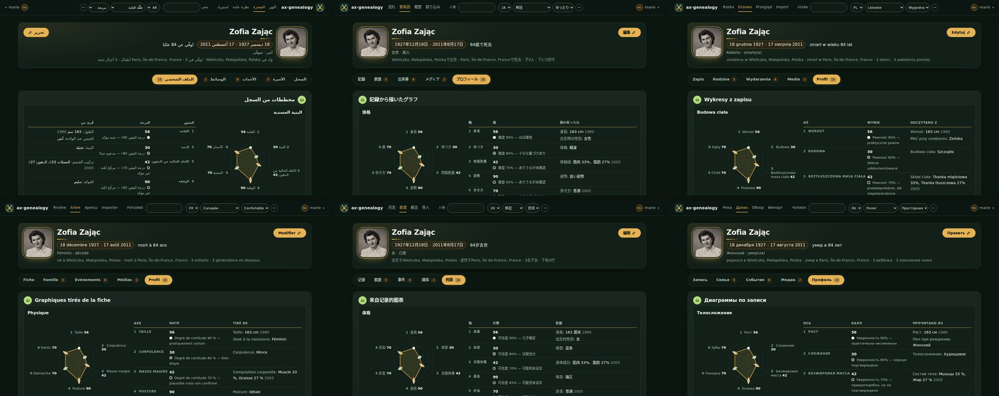](docs/screenshots/languages.jpg)

---

## What is released

The latest release is **v1.0.0**, the first major version. Over v0.6.0 it
adds:

- the tree page as a family chart read down the page: a column per
  generation, the line to each child in their colour (a son blue, a daughter
  red) and, for an adoption, a fostering or a step-child, its pattern;
  compact cards that open on the portrait, the dates and the record; nobody
  cut off at any width;
- on a phone, the tree as a column of generations, and in every view a first
  tap on a person that names them;
- five themes redrawn: Canopy's valley seen at 60°, its water and its
  herds alive; Clarity's funnel in rings, names on the glass; Fusion in
  right angles, orange down and green up; Galaxy's two sides, fields and a
  spiral galaxy; Genealogy closer to its tree.

v0.6.0 brought the merge of two records, the GEDCOM conversion of axgf-rs
0.6.1 and records that agree with the people they describe. v0.5.0 brought
the living river and its zoom, the six themes, fourteen languages, the
family's notes, the administration console, registration and sign-in with a
service, and the GEDCOM reader for every version.

The installer installs releases. `--from-source` builds `main`.
[CHANGELOG.md](CHANGELOG.md) has the details, version by version.

---

## Install

On a fresh Ubuntu LTS server, as a user who can `sudo`:

```sh
curl -fsSLO https://github.com/plkarin/axgf-cms/releases/latest/download/bootstrap.sh
curl -fsSLO https://github.com/plkarin/axgf-cms/releases/latest/download/bootstrap.sh.sha256
sha256sum -c bootstrap.sh.sha256 && sudo bash bootstrap.sh --with-sample
```

The installer is the one the release ships, checked against its checksum. It
installs exactly that release. Today that is **v1.0.0**, and it reads AXGF 1.0
and 1.1 files.

To install a particular release, fetch the same two files from
`releases/download/<tag>/` instead of `releases/latest/download/` (v0.3.1 or
later; earlier releases shipped no installer). To build what is on `main`
instead, use `--from-source`, which needs
`cargo` on root's `PATH`. Every release, with its binaries and checksums, is
on the [releases page](https://github.com/plkarin/axgf-cms/releases).

`--with-sample` seeds a small demonstration family, so a fresh install has
something to look at. It is smaller than the family in the screenshots above.
Leave it out to start with an empty tree. At the end the script prints the
address, an administrator's username and password, and the emergency token,
**once**. Keep them.

### What the installer does

Read it first if you like: [`deploy/bootstrap.sh`](deploy/bootstrap.sh). Add
`--dry-run` and it prints every step without changing anything. In order, it:

1. Checks the machine's architecture (x86-64 or ARM64).
2. Downloads the release binary and its `.sha256`, refuses to go on if the
   checksum does not match, and installs it as `/usr/local/bin/axgf-cms`.
   (`--from-source` clones this repository and builds it instead.)
3. Creates a system user `axgf-cms` with no login shell.
4. Creates `/var/lib/axgf-cms` for the data, owned by that user.
5. Writes the settings, including a generated emergency token, to
   `/etc/axgf-cms/env`, readable only by root and the service (`0640`).
6. Creates the family file: empty, or the demonstration family.
7. Creates the first administrator account and generates its password.
8. Installs and starts three systemd units: the service itself (sandboxed,
   bound to `127.0.0.1:8080`), a **daily backup** at 03:30, and a **weekly
   check** that reads the data and the newest backup back in full.
9. Waits until the service answers `/health` with the family's data readable,
   then prints what you need to sign in.

Run it again at any time: it will not overwrite your family file, your
accounts or your token. `--uninstall` removes the service and the binary and
**never** the data.

### Then sign in

Open the address it printed and sign in with the administrator it created.
There is no web page that creates the first account, on purpose: an
installation is never left open to whoever finds it first. If you left
`--with-sample` out, the family is empty. An installation built from `main`
then offers you the [three ways in](#first-start-three-ways-in). A release
lets you add the first person. Its **Import** page converts a GEDCOM into an
`.axgf` you can download, but setting an installation up from one is new in
0.5.0.

---

## Running it

It is an ordinary systemd service:

```sh
systemctl status axgf-cms           # is it up, what is it serving, when was the last backup
sudo systemctl restart axgf-cms     # after editing /etc/axgf-cms/env
sudo systemctl stop axgf-cms        # finishes any save in progress first
journalctl -u axgf-cms -f           # what it is doing
systemctl list-timers 'axgf-cms*'   # when the next backup and check run
```

Relatives get their accounts from **Admin → Accounts**, or open one
themselves if you allow it there: freely, only with the family's secret, or
not at all (the default). With a sign-in service set up under **Admin →
Connectivity**, a relative whose address you entered signs in with Google in
one click. There are three roles: a **viewer** reads, a
**contributor** also adds and corrects (optionally within one branch of the
family), and an **admin** also manages accounts, deletes, deduplicates and
exports. [docs/FAMILY.md](docs/FAMILY.md) is a guide you can send them.
Everything else an operator needs is in [docs/OPERATOR.md](docs/OPERATOR.md).

## Where your data lives

```
/var/lib/axgf-cms/
  family.axgf        the family — the only file that matters
  family.acl         the accounts (password hashes), mode 600
  family.journal     who changed what, and when
  backups/           the daily archives
  .axgf-cms-cache/   photographs unpacked for serving; rebuilt if deleted
```

**The whole family is `family.axgf`**: every person, relationship, date,
source, scanned certificate and photograph, in one file. It is an ordinary ZIP
of JSON files with the attachments inside, so you can copy it, keep it on a
USB stick, or open it with any unzip tool, with or without this program. It is
yours: **Admin → AXGF bundle** downloads it at any time.

The accounts and the edit history are deliberately *not* inside it. The family
file is made to be copied and sent to people; password hashes and a record of
who corrected what are not.

## Security: it listens on localhost only

**The service binds `127.0.0.1` and must stay there.** It speaks plain HTTP.
Exposed directly, with `--bind 0.0.0.0` and nothing in front of it, every
password typed into the sign-in form crosses the network in clear text, and a
family's private records are readable by anyone who can reach the port.

To put it on the internet, keep it on localhost and put a reverse proxy in
front that terminates TLS. Two configurations ship in
[`deploy/proxy/`](deploy/proxy/), each tested in front of a live instance:

- [`Caddyfile`](deploy/proxy/Caddyfile): Caddy obtains and renews the
  certificate itself. Replace the site name and the email, copy it to
  `/etc/caddy/Caddyfile`, reload Caddy.
- [`nginx-axgf-cms.conf`](deploy/proxy/nginx-axgf-cms.conf): for nginx with a
  certificate from certbot.

Both set the `X-Forwarded-Proto` header that makes the session cookie `Secure`,
allow uploads up to the application's own limit, and wait long enough for a
large save. [docs/OPERATOR.md](docs/OPERATOR.md#publishing-it-tls-and-a-reverse-proxy)
has the details.

Inside, passwords are hashed with Argon2id, sign-in attempts are throttled,
and the session cookie is `HttpOnly` and `SameSite=Strict`. Every form must
be posted from the site itself (its `Origin`, else its `Referer`), and a page
shown to someone signed in is never cached. Sign-in services use the
authorization code with PKCE, `state` and `nonce`, and check every claim of
the token they get back. The sign-in services need the server to reach them:
the service as installed allows no outgoing connection, and
[docs/adr/0012](docs/adr/0012-the-ways-in.md) says how to open it. Visibility is
enforced on the server on every read path. A person you may not read is
redacted, not omitted: they keep their place in the tree, with no name and no
dates.

**Before you publish a tree imported from GEDCOM:** GEDCOM records no privacy
settings, so an imported tree has none. Until you set them person by person,
anyone recorded as living is shown only to signed-in relatives and everybody
else is public. Check that is what you want.

## Backup and restore

Backups happen on their own: one verified archive a day, kept as 7 daily,
4 weekly and 12 monthly, in `/var/lib/axgf-cms/backups/`. Each is a plain ZIP
holding the family file, the accounts and the edit history, and is read back
in full before it is kept. To back up right now:

```sh
sudo systemctl start axgf-cms-backup.service
```

**A backup on the same disk does not survive that disk.** Copy the archives
somewhere else, for example nightly with
`rsync -a /var/lib/axgf-cms/backups/ backup@othermachine:/srv/axgf/`.

To restore, stop the service and give it an archive. What is there now is
moved aside, not deleted:

```sh
sudo systemctl stop axgf-cms
sudo -u axgf-cms axgf-cms restore --bundle /var/lib/axgf-cms/family.axgf \
  /var/lib/axgf-cms/backups/axgf-backup-20260923T200223Z.zip
sudo systemctl start axgf-cms
```

## Upgrade

```sh
curl -fsSLO https://github.com/plkarin/axgf-cms/releases/latest/download/bootstrap.sh
curl -fsSLO https://github.com/plkarin/axgf-cms/releases/latest/download/bootstrap.sh.sha256
sha256sum -c bootstrap.sh.sha256 && sudo bash bootstrap.sh --upgrade
```

It backs up first, keeps the working binary aside, installs the new one,
restarts, and checks that the family's data is readable. If it is not, it puts
the previous version back on its own. Without `--version` it upgrades to the
latest stable release.

From 0.5.0 an administrator can do the same from **Admin → Infrastructure →
Change version**, which asks the helper `bootstrap.sh` installs beside the
service. While the repository is private, the helper needs a GitHub token in
`/etc/axgf-cms/github-token`, readable by root only
([docs/OPERATOR.md](docs/OPERATOR.md#from-the-infrastructure-page-050)).

## Languages

The site speaks fourteen languages. **Two of them, English and French, have
been reviewed by someone who speaks them. The other twelve (Polish, Russian,
German, Italian, Spanish, Portuguese, Chinese, Japanese, Arabic, Hebrew,
Swahili and Lingala) are complete but unreviewed:** every message is
translated, and nobody has checked them. In genealogy that matters, because the right word for a union, a
godparent or a primary source depends on each country's record-keeping
tradition. The language menu marks which is which, and
[CONTRIBUTING.md](CONTRIBUTING.md) says where to start if you can help.

---

## Opening a `.axgf` file on your own computer

*For a relative on Windows or a Mac who has been sent a family file. You do
not need a server, a proxy or a certificate.*

**The easiest way is not to run anything:** ask whoever looks after the family
site for an account, and read it in your browser.
[docs/FAMILY.md](docs/FAMILY.md) explains how. The file itself is also a
plain ZIP, so any unzip tool shows you what is inside, as text.

Running this program on your own computer is possible only on some systems
today, and it is honest to say so up front:

| Your computer | Can you run it? |
|---|---|
| **Linux** | **Yes.** Download the current release, [`v1.0.0`](https://github.com/plkarin/axgf-cms/releases/tag/v1.0.0), for x86-64 or ARM64; it opens AXGF 1.0 and 1.1 files alike. |
| **Mac** (Apple Silicon or Intel) | **Not yet, without help.** There is no Mac download. The program *builds* for both kinds of Mac, but nobody has run it on one, so it is untested. Someone with Rust installed can build it with `cargo install --git https://github.com/plkarin/axgf-cms --locked`. |
| **Windows** | **No.** It does not currently build for Windows: parts of it that check disk space and file permissions use Unix-only calls. Windows Subsystem for Linux (WSL) may run the Linux version, but that has not been tested either. |

On Linux, or on a Mac with a build, in a terminal, in the folder holding the
file:

```sh
./axgf-cms --bundle family.axgf
```

It prints an **admin token** (a long string of letters and digits) and
`listening on http://127.0.0.1:8080`. Open that address in your browser, click
**Sign in**, open the folded *emergency token* section, and paste the token.
You can now see everything in the file. Press **Ctrl-C** in the terminal to
stop. Nothing leaves your computer: it only listens on `127.0.0.1`.

**Edits you make go into `family.axgf` itself.** Keep an untouched copy of the
file you were sent.

What will not work away from the Linux server: the installer, the automatic
backups and weekly checks (they are systemd timers), and logging to the system
journal; the program writes its log to the terminal instead.

---

## Questions

**Can I get my family back out as GEDCOM?** No, and that is deliberate.
GEDCOM has nowhere to put how sure a fact is, a relationship outside the
family, the length of a job, or a date nobody could pin down, so the return
trip would quietly drop all of it. The family exports whole instead, as the
`.axgf` itself: plain JSON that any tool can read.

**Does anything leave my server?** Not unless you ask for it. It is a single
program that serves the pages, the photographs and the charts itself, with no
third-party accounts and no trackers. Two conveniences reach outside, and
both are off until you switch them on. Looking up a place's position asks a
geocoder (Nominatim, or one you run), through the server. A clickable map in
the place editor loads its tiles from the tile server you name, in the
editor's browser. `axgf-cms --help` describes both flags, `--geocoder-contact`
and `--map-tiles`.

**What if this project stops?** Your family is still a ZIP of JSON in a
[documented format](https://github.com/plkarin/axgf-spec), with your
photographs and documents inside, next to the JSON that describes them.

## Built on an open format

`.axgf` is the [Axiom Genealogy Format](https://github.com/plkarin/axgf-spec),
and every read, check and change of it goes through the
[`axgf-rs`](https://github.com/plkarin/axgf-lib) library.

## More

- [docs/OPERATOR.md](docs/OPERATOR.md): running it day to day: health, disk,
  backups off the machine, what to do when something is wrong
- [docs/DEPLOY.md](docs/DEPLOY.md): installing by hand, and the systemd units
- [docs/FAMILY.md](docs/FAMILY.md): for relatives with an account
- [docs/REFERENCE.md](docs/REFERENCE.md): every flag and route, attachments,
  accounts and roles, and how it is built
- [docs/adr/](docs/adr/): the decisions behind the river, the themes and the
  set-up, and why
- [CHANGELOG.md](CHANGELOG.md): what changed, version by version
- [CONTRIBUTING.md](CONTRIBUTING.md): development and translations

Developing: `cargo test`, `cargo clippy --all-targets -- -D warnings`,
`cargo fmt --check`.

## Licence

Apache-2.0. See [LICENSE](LICENSE).
